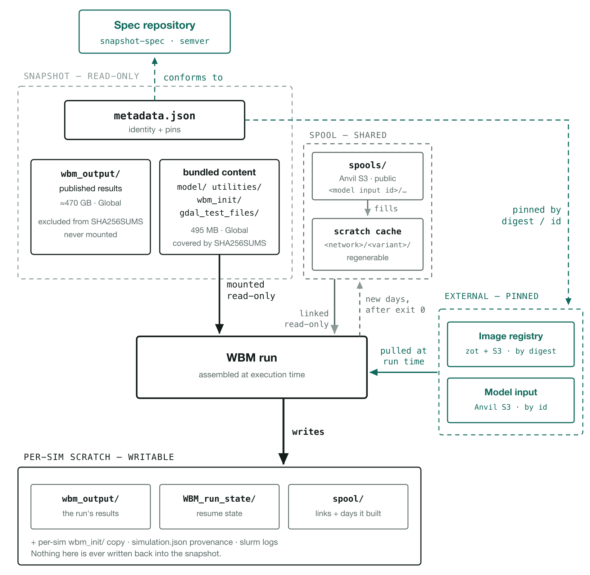
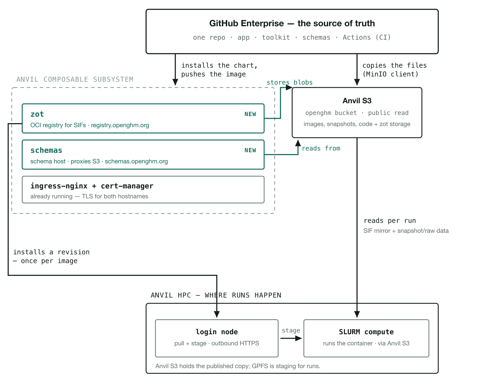

# Artifact versioning — architecture

How a WBM simulation is identified, stored, and reproduced.

**Status: target.** This is the shape we are building toward — the page the
mission list is derived from. Most of it does not run yet: no snapshot
carries a `metadata.json`, and only three images are published (below). Where
something *does* already exist, the text says so. Read it as a description of
the destination, never as a description of the system.

The gateway that runs today is a different document:
[gateway.md](gateway.md).

This document is **stable by design**: it describes shape, not procedure. The
reasoning behind each choice is in [`../decisions/`](../decisions/); the exact
commands, formats and environment values are in
[`../reference/`](../reference/); the work to build any of it is a mission in
`ops/missions/` (private).

---

## 1. The unit: a snapshot

A **snapshot** is one folder that reproduces one WBM simulation — code, run
configuration, a link to the inputs, and the output it produced.



*What is bundled, what is pinned, and what the run produces. Solid edges move
bytes; dashed accent edges are declarations in `metadata.json`. The snapshot is
mounted read-only, so everything the run produces lands in per-simulation
scratch.*

The snapshot folder holds the model code, run configuration, the identity
manifest, and `metadata.json` — plus two things that are deliberately *not* part
of its identity: a regenerable `spool/` cache, and the `wbm_output/` it produced
([ADR 0009](../decisions/0009-output-is-carried-not-reproducible.md)). Those two
are about 95 % of a published snapshot's bytes, which is why what to ship is a
real decision rather than a detail.

Input data is **not** in the folder. It is a separately published artifact that
`metadata.json` links by id, materialised at `data/<mountAs>/` when the run is
assembled ([ADR 0015](../decisions/0015-model-input-is-a-published-artifact.md)).
Bundling it meant every snapshot stored its own copy of the same 49 GB.

Exact tree and sizes: [`../reference/snapshot-layout.md`](../reference/snapshot-layout.md).

## 2. Five axes

Five artifacts version independently. One snapshot's `metadata.json` pins all
five ([ADR 0002](../decisions/0002-five-versioned-axes.md)).

| # | Artifact | Identifier — what a pin cites | Assigned by | Verifiable against |
|---|---|---|---|---|
| 1 | Snapshot spec | semver | us, per change | n/a — the version *is* the contract |
| 2 | Snapshot instance | minted id | the publisher, at publish | `SHA256SUMS` |
| 3 | Model input | minted id | the publisher, at publish | `SHA256SUMS` |
| 4 | Container image | `sha256` digest | the build | digest + lock record |
| 5 | WBM code | `sha256` tree hash | the code | `TREEHASH` |

Only axis 4 is still **recorded rather than chosen** — an OCI digest falls out
of the build and is also the address the image is pulled by. Axes 2 and 3 were
content hashes until
[ADR 0014](../decisions/0014-identity-is-a-minted-id.md): their ids are now
minted at publish time, unique but not derived from the bytes, and integrity
moved to a separate, optional check against `SHA256SUMS`.

Three kinds of identifier appear above, and they behave differently:

| Kind | Rule | Used by |
|---|---|---|
| **Contract** — semver | MAJOR bump on a breaking change | axis 1 |
| **Minted** — random id | assigned once at publish, never reused, never reassigned | axes 2, 3 |
| **Content** — digest | the hash *is* the identity; different bytes are a different version | axis 4 |

Tags and slugs are mutable aliases for humans. **Pins always cite a minted id or
a digest.**

> **Open** — what axis 5 cites. `modelCode.sha256` is a checksum of ours, and
> [ADR 0014](../decisions/0014-identity-is-a-minted-id.md) moved those out of
> `metadata.json`, leaving `TREEHASH` inside the artifact as the integrity check.
> Pinning the code by its curated `wbm-code/<name>/<version>` address is the
> obvious replacement, but it has not been decided.

## 3. Storage

One Anvil S3 bucket, `openghm`, is the published destination for everything.
Anvil's GPFS project space is staging — where snapshots are assembled and where
jobs read from — not the archive.

```
openghm/
  snapshots/<id>/…                   # minted id — an open namespace
  model-inputs/<id>/…                # minted id — an open namespace
  wbm-code/<name>/<version>/…        # curated
  containers/<name>/<version>/…      # curated — plain-S3 SIF mirror
  registry/…                         # zot's own blob store, opaque
  schemas/snapshot-spec/…            # the spec's published files
```

**The namespace decides the key, not the kind of artifact**
([ADR 0005](../decisions/0005-namespace-decides-the-key.md)): snapshots and
model inputs are the prefixes users publish into, so their keys are minted ids
that cannot collide with a name somebody else picked
([ADR 0014](../decisions/0014-identity-is-a-minted-id.md),
[ADR 0015](../decisions/0015-model-input-is-a-published-artifact.md)); the rest
are curated by us, so a readable path is worth more. Integrity never depends on
the path: every prefix ships a manifest, and checking it is a step of its own.

Per-prefix rules and mutable objects:
[`../reference/s3-layout.md`](../reference/s3-layout.md).

## 4. What runs where



*Three tiers, all within Anvil except the git host: Purdue GitHub Enterprise
publishes; Anvil's Composable Subsystem and Anvil S3 serve; Anvil's HPC side
consumes. The two accented boxes are the only new workloads.*

Two new workloads, both in the `openghm` namespace on the Composable
Subsystem, **neither holding state** — both keep their bytes in Anvil S3, so a
rescheduled pod loses nothing and there is no volume to back up:

| Workload | Job | Hostname | Decision |
|---|---|---|---|
| **zot** | OCI registry for SIFs | `registry.openghm.org` | [ADR 0003](../decisions/0003-zot-as-sif-registry.md) |
| **nginx** | proxies the spec's schemas out of S3 | `schemas.openghm.org` | [ADR 0007](../decisions/0007-schemas-on-s3-behind-a-proxy.md) |

Everything else already exists: the namespace and its ingress, the bucket, and
the Anvil install root.

**zot is no longer target — it is deployed and live**
(`2026-09-25-zot-deploy`, private): one pod, anonymous read, htpasswd
publisher auth, backed by Anvil S3 under `registry/`. Three images are
published so far — `wbm-v1-lite`, `wbm-v2-lite`, `wbm-tools-lite`, all
`openghm/<name>:<tag>` — mirroring the S3 layout above, `containers/` is no
longer empty either. Each of the three has a committed lock record,
`images/<name>/lock/<version>.lock.json`, read from the published SIF
itself and backed by a fresh prod-comparison run
([metadata-format.md](../reference/metadata-format.md#container-lock-record)).
That is axis 4's "digest + lock record" made real for them. Neither the
`-s3` image variants nor a CI-driven publish path exist yet; both are still
target, and neither has a lock record.

The two edges into the HPC tier are **different operations**, not two ways of
doing the same thing:

| Edge | What it is | Frequency |
|---|---|---|
| zot → login node | *installing* a revision into the shared tree | once per image revision |
| Anvil S3 → compute node | a *job* reading what it needs | every run |

The install is a login-node task because it produces shared, persistent state —
a SIF under a versioned path plus a modulefile — that must exist before any job
references it.

## 5. The spec

The snapshot spec is the contract every snapshot declares conformance to. One
semver version covers two files, because they are checked two different ways
([ADR 0006](../decisions/0006-spec-is-two-files.md)): a **JSON Schema** for
`metadata.json`'s fields, and a **plain path list** for the folder layout,
which JSON Schema cannot express.

It lives in `schemas/` in this repository and is generated outward — into the
backend model, the frontend types, and a copy bundled in the `openghm` wheel
for offline validation. That is why the application, the toolkit and the spec
share one repository ([ADR 0001](../decisions/0001-unified-repository.md)).

Field vocabulary, publish URLs, and version rules:
[`../reference/snapshot-spec.md`](../reference/snapshot-spec.md).

## 6. Tying it together

Every axis resolves from one object — the pin block in a snapshot's
`metadata.json`:

```json
{
  "$schema": "https://schemas.openghm.org/snapshot-spec/metadata/1.0.0.json",
  "id": "3f9c1a…",
  "slug": "wbm_storage_v2.0.0",

  "simulation": { "init": "wbm_test.init" },

  "uses": {
    "container": { "image": "wbm-v2-lite", "version": "2.0.0-r3",
                   "digest": "sha256:9f2c…", "oras": "…", "https": "…" },
    "modelInput": { "id": "7d4e9a…", "mountAs": "wbm_ancillary_data_v2.0.0" }
  }
}
```

Full field reference:
[`../reference/metadata-format.md`](../reference/metadata-format.md).

---

## Where the rest went

| You want | Look in |
|---|---|
| Why a choice was made, and what lost | [`../decisions/`](../decisions/) |
| Exact paths, endpoints, versions, formats | [`../reference/`](../reference/) |
| How to build any of this | `ops/missions/` (private) |
| What is still undecided | [`../reference/open-items.md`](../reference/open-items.md) |

Diagram sources are in [`diagrams/`](diagrams/); rasterize with
`rsvg-convert -z 2 -b white -o diagrams/img/<name>.png diagrams/<name>.svg`.
